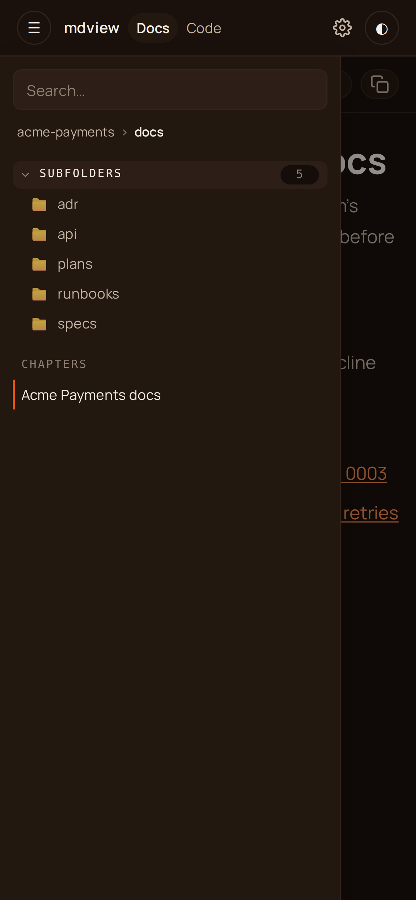

<h1 align="center">mdview</h1>

<p align="center">
  <strong>Click, read and fix the docs your AI agent writes — even on a remote server.</strong>
</p>

<p align="center">
  <a href="LICENSE"></a>
  
  
  
</p>

<p align="center">
  Your agent finishes with <code>Wrote docs/plans/payment-retry.md</code>, a path you can't click.
  mdview turns it into a link: click it and the doc opens in your browser, rendered for
  comfortable reading, with an Edit button when something's wrong.
  No IDE, no hunting through folders, no extra tool.
</p>

---

## Why mdview?

Coding agents increasingly run where the code runs: a dev server over SSH, a cloud box,
a VM, WSL. They write plans, specs and reports there, then hand back a relative path.
To read one, you connect an IDE, dig through the tree, and squint at raw markdown —
tables out of line, Mermaid as code.

mdview runs next to your agent. The agent hands you a URL instead of a path, you click it
from your laptop or phone, and the whole project is there: every cross-folder link
resolved, diagrams drawn, search across all docs, and live reload while the agent keeps writing.

| | |
|---|---|
| 🤖 **A link, not a path** | `mdview open --json <file>` (or the `mdview_view_file` MCP tool when there is no shell) hands your agent a clickable URL the moment it writes a doc. |
| 📱 **Read anywhere** | Responsive layout, mobile sidebar drawer, light & dark. Browse from your laptop or phone over the LAN or an SSH tunnel, behind a login token. |
| 🔗 **Nothing 404s** | Every internal link across every folder is resolved into one URL namespace. Click straight through `../`, `./sub/`, anchors — no dead ends. |
| 📊 **Diagrams that move** | Mermaid renders client-side with pan / zoom / fullscreen — and pinch-to-zoom on mobile. |
| ↔️ **Expandable tables** | Wide tables stay in the text column and scroll sideways; one click on the button in the header row widens them to the full page, and back. |
| ✏️ **Edit in place** | Hit Edit on any doc, fix it in a CodeMirror editor with markdown highlighting, Ctrl+S saves straight to disk and re-renders. Refuses to clobber a file your agent changed meanwhile. |
| ⚡ **Live reload** | A filesystem watcher pushes changes over WebSocket. Save on disk, the page updates itself. |
| 🔍 **Find anything** | Full-text search across the entire project (SQLite FTS5) plus fuzzy file-jump. |
| 📋 **Copy-ready code** | Syntax-highlighted code blocks with a one-tap copy button. |
| 🦀 **One binary** | Written in Rust. No runtime, no Node, no Docker. Install and go. |

---

## See it

https://github.com/user-attachments/assets/ddc36bcb-4bcc-4894-b2fe-fb93639fa853

<table>
  <tr>
    <td colspan="2"><br><em>Reading view — file tree, rendered doc, on-this-page TOC, backlinks</em></td>
  </tr>
  <tr>
    <td width="50%"><br><em>Mermaid with pan / zoom / fullscreen</em></td>
    <td width="50%"><br><em>Project-wide full-text search</em></td>
  </tr>
  <tr>
    <td><br><em>Edit in place — the preview follows as you type</em></td>
    <td><br><em>Wide table widened to the full page</em></td>
  </tr>
</table>

<p align="center">
  
  &nbsp;
  
  <br><em>On a phone — the same doc, and the folder drawer</em>
</p>

---

## Install

```sh
curl -fsSL https://raw.githubusercontent.com/vantt/mdview/main/install.sh | sh
```

Windows (PowerShell):

```powershell
irm https://raw.githubusercontent.com/vantt/mdview/main/install.ps1 | iex
```

The shell installer puts `mdview` in the first writable folder of `/usr/local/bin`,
`~/.local/bin` and `~/.mdview/bin` (on Windows: `%USERPROFILE%\.mdview\bin`). If it warns
that the folder is not on your `PATH`, add it (or open a new shell) before you go on.

Upgrade later with `mdview update` (`--check` to only look; see [usage](docs/usage.md#upgrading)).
Remove it with `mdview uninstall` (`--purge` also deletes config and index; see [usage](docs/usage.md#uninstalling)).

Or from source (needs Rust):

```sh
cargo install --git https://github.com/vantt/mdview mdview
```

---

## Quick start

```sh
mdview open docs/architecture.md
```

This starts mdview's background server (the *daemon*) if it is not running yet, indexes the
file and its neighbours, and prints a link. Open it and sign in with the login token
**`demo`**. <http://localhost:7700> lists every project you have opened; edits on disk
live-reload the page.

Out of the box the daemon listens on every network interface (port 7700) with that default
token, so it works from your laptop or phone right away. To lock it down, set your own
`web_secret` in `~/.mdview/config.toml` (`mdview config edit`) and run `mdview restart`.

---

## Use it with your agent

Run this once in each project, from the project root:

```sh
mdview doctor --fix
```

It sets up three things:

- **An instruction block** in `AGENTS.md` and `CLAUDE.md` in the current folder (it creates
  them if they are missing). It tells the agent to run `mdview open --json <file>` after it
  writes a doc and to hand you the link, so you don't have to ask.
- **A Claude Code permission**, `Bash(mdview open:*)` in `~/.claude/settings.json`, so Claude
  Code runs that command without prompting (after a timestamped backup; a settings file that
  is not valid JSON is never touched).
- **The `/mdview` skill** for Claude Code: type `/mdview docs/spec/prd.md` to get a link on
  demand.

The permission and the skill are global; the instruction block is per project. To add the
block by hand (say, to your global `~/.claude/CLAUDE.md`), copy it from
[`docs/mdview-agents-template.md`](docs/mdview-agents-template.md).

**No shell, as in Claude Desktop?** Use MCP (Model Context Protocol, how such apps call
external tools) instead:

```sh
mdview doctor --fix --mcp
```

This registers a small MCP server (`mdview mcp`, tool **`mdview_view_file(project_root,
relative_path)`**) with Claude Desktop, and with Claude Code, Codex and Antigravity when
detected. It is a thin proxy that runs `mdview` per call, so an `mdview update` takes effect
without reconnecting. With mdview inside WSL, Claude Desktop on Windows is registered
through `wsl.exe`.

---

## Reading from a remote server

Install mdview on the server, next to your agent. Nothing to configure: the daemon listens
on `0.0.0.0:7700` and the links it hands out carry the server's address, so any laptop or
phone that can reach the server (same LAN, a VPN, Tailscale) opens them with a click.

To show a friendlier name in the links, such as `build-01` or a Tailscale name, set
`hostname` under `[server]` in `~/.mdview/config.toml` and run `mdview restart`.

**Only have SSH?** Forward the port with `ssh -L 7700:localhost:7700 user@host` and set
`hostname = "localhost"`, so the links open through the tunnel. Cloudflare Access can stand
in for the login token; see the [usage guide](docs/usage.md#authentication).

---

## CLI

```sh
mdview open <file.md>                # print the browser URL (auto-starts the daemon)
mdview list                          # registered projects and their ids
mdview search "query" --project ID   # full-text search in one project (FTS5)
mdview register <dir> [--name ...]   # register a project (indexed on view/search)
mdview status                        # is the daemon up?
mdview config edit                   # edit ~/.mdview/config.toml in $EDITOR
mdview restart                       # restart the daemon (apply config changes)
mdview doctor [--fix] [--mcp]        # diagnose & repair the integration
mdview serve [--host H] [--port P]   # optional: pre-start / bind a custom address
```

Most commands accept `--json` for scripting. Full reference, settings, upgrading and the
desktop app live in the **[usage guide](docs/usage.md)**.

---

## How it works

One daemon owns the registry (`~/.mdview/registry-v4.db`); browser tabs are just clients. On an
`open` / `view_file` call the server auto-creates the project, indexes the target file (plus its
link targets and sibling markdown files), and returns the URL; the whole project is indexed on
its first content search. Nothing scans the repo in the background, and projects idle for
14 days are cleaned up. A filesystem watcher keeps the index current and pushes a reload
signal over WebSocket.

- **Rendering:** comrak (GFM) → server-side syntect highlight → ammonia sanitize. Mermaid renders client-side.
- **Search:** SQLite FTS5.
- **Safety:** only registered project roots are served; path traversal is guarded and project HTML is sanitized before it's sent.

---

## Status

Actively developed. Core viewer, project-wide search, MCP + CLI + `doctor`, and the mobile
UX are working end-to-end; a native desktop shell (Tauri) is experimental. See
[PRD.md](PRD.md) for the full design.

---

## Credits

mdview is an independent project, but its design leans on ideas and hard-won lessons from two
prior open-source markdown servers. Grateful thanks to both:

- **[mdserve](https://github.com/jfernandez/mdserve)** — Jose Fernandez, MIT. Watcher
  robustness across atomic editor saves, WebSocket reload-signal live reload, the
  pre-render-to-memory pipeline, path-traversal guarding, and port auto-increment on bind conflict.
- **[marky](https://github.com/GRVYDEV/marky)** — GRVYDEV, Apache-2.0. Recursive folder tree
  that respects `.gitignore`, atomic corrupt-resilient settings persistence,
  sanitize-before-serve, and nucleo-backed fuzzy search.

## License

MIT — see [LICENSE](LICENSE).
