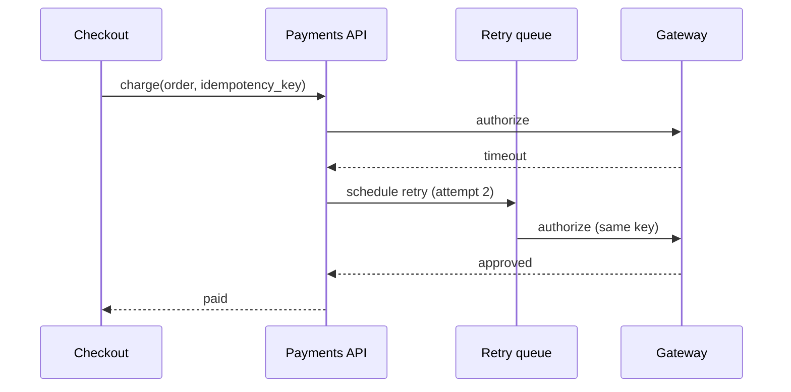

# Payment retry plan

Retry failed card payments without charging a customer twice. Builds on [ADR 0003: retry policy](../adr/0003-retry-policy.md) and the [payments API](../api/payments.md).

## Goals

- Recover payments that fail for temporary reasons (network, issuer timeout).
- Never double-charge: every attempt carries the same idempotency key.
- Give support a clear trail of every attempt.

## Retry schedule

| Attempt | Delay | Applies to |
|---|---|---|
| 1 | immediately | network errors, `5xx` from the gateway |
| 2 | 30 s | issuer timeout |
| 3 | 5 min | issuer timeout, `insufficient_funds` |

## Flow



## Config

```yaml
payments:
  retry:
    max_retries: 10
    backoff: [0s, 30s, 5m]
    idempotency: required
```
