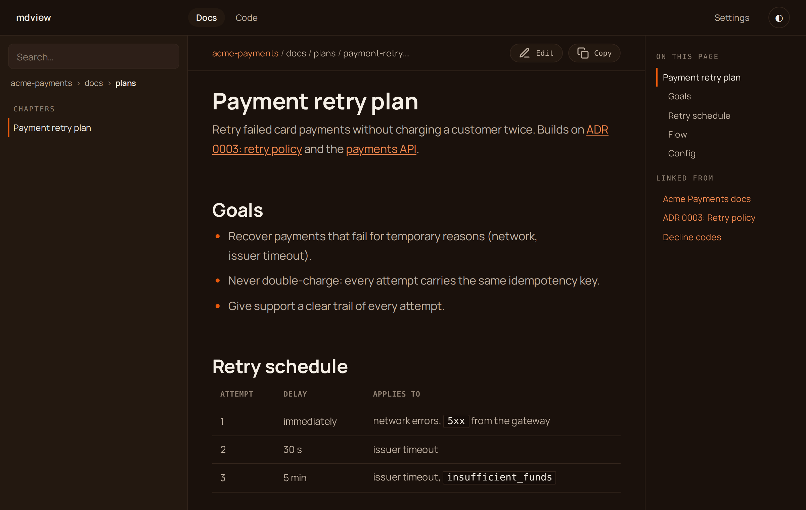
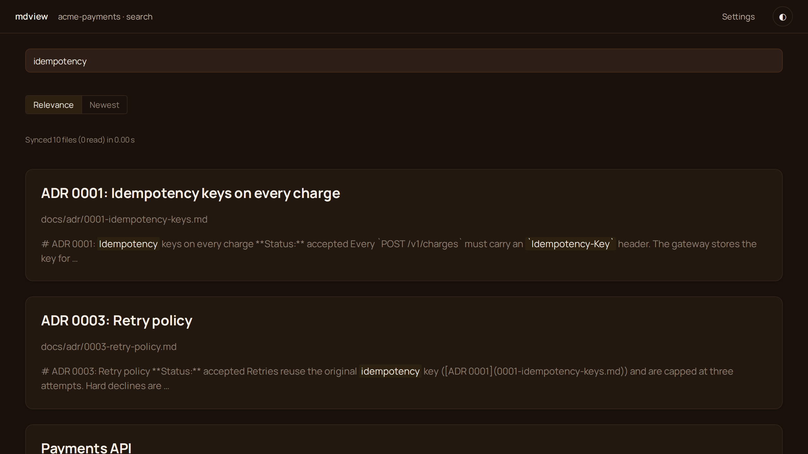
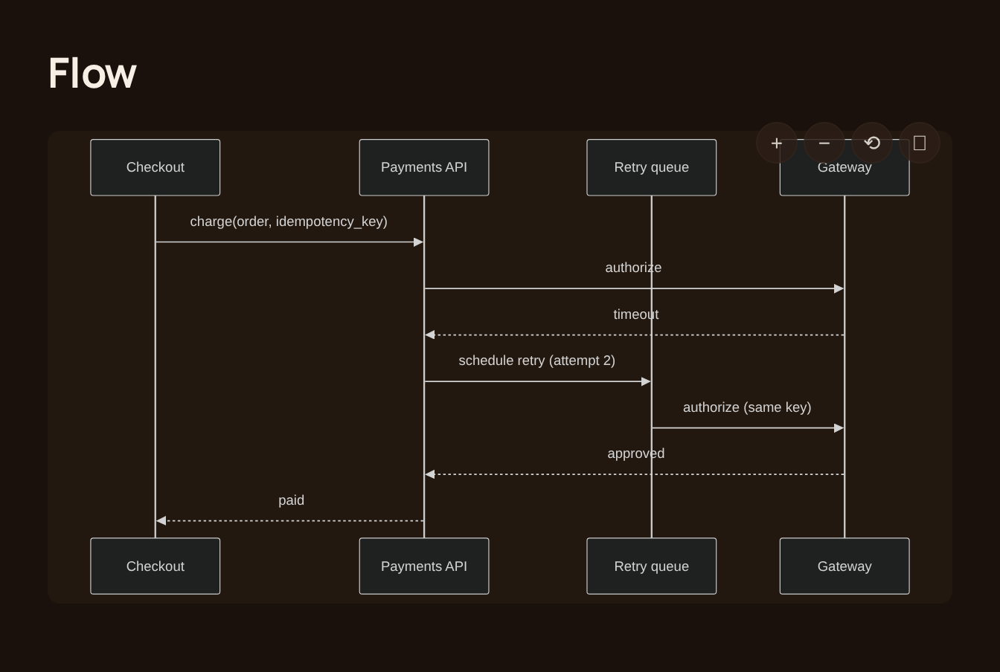
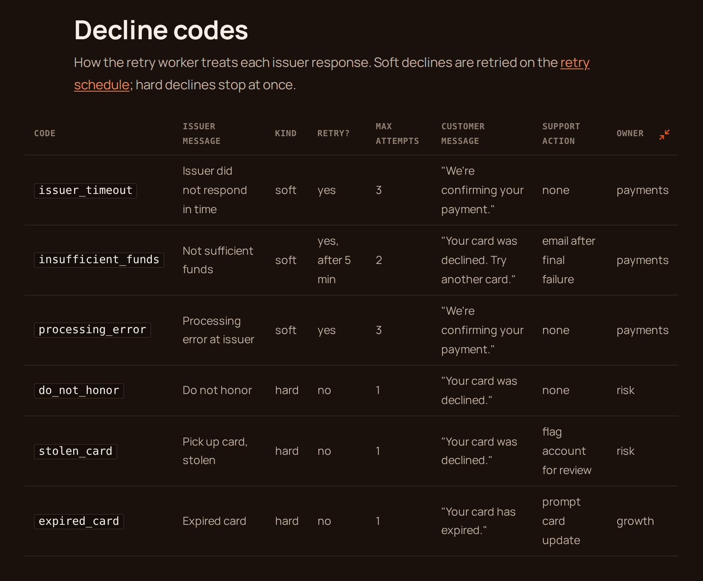
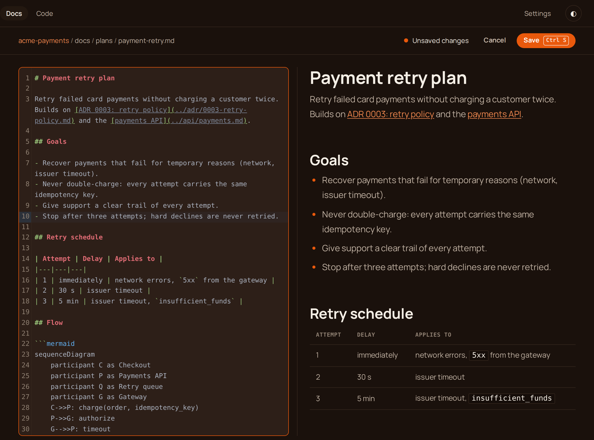
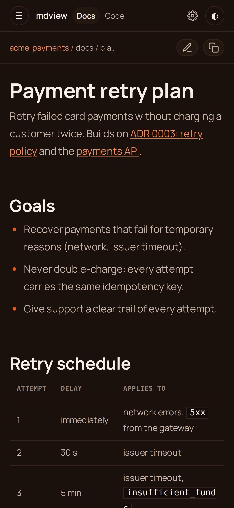
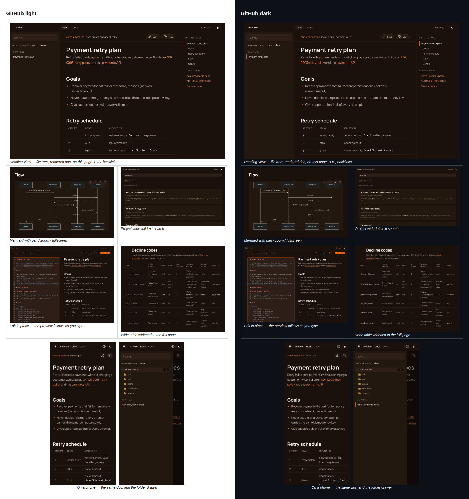

# README mdview — đánh giá trải nghiệm người mới (2026-10-27)

Đi theo `README.md` từ đầu như người lạ, trên máy sạch (`HOME` tạm, `PATH` không có `~/.local/bin`).
Repo đã `git fetch`: main khớp `origin/main` (`6c6b2a9`). Không sửa gì trong repo mdview.

**Phiên bản:** binary của anh là `0.8.8`. Release mới nhất (bản `install.sh` tải về) là `0.8.9`.
Trên main còn có `5f2c3a2` (sửa lề trái CSS), **chưa phát hành**. Ảnh nháp chụp từ build của main.
Nên phát hành `0.8.10` trước launch, để bản người dùng cài khớp với ảnh.

## 1. Vấn đề, xếp theo mức độ

### P0: chặn người mới, hoặc README nói sai

| # | Vấn đề | Bằng chứng (đã chạy thật) | Đề xuất |
|---|---|---|---|
| 1 | **Không biết login token.** `mdview open` tự bật daemon. Token mặc định `demo` chỉ được in ra stdout của daemon, nên người dùng không thấy. Trang `/login` chỉ có ô "Token", không gợi ý gì. Người mới click link, gặp trang login, rồi kẹt. | `mdview open docs/architecture.md` chỉ in URL. `curl` URL đó trả `303 → /login`. | README nói rõ: token mặc định là `demo`, nằm ở `web_secret` trong `~/.mdview/config.toml`, và nên đổi đi. Riêng phần code, có thể cho `open` in token ở lần chạy đầu, hoặc thêm gợi ý ở trang login. Đây là commit riêng, anh quyết. |
| 2 | **README sai về token và địa chỉ bind.** README nói token "auto-generated", nhưng thực tế là `demo` cố định (`server.rs:121`). README viết "can also bind your LAN (`--host 0.0.0.0`)", nhưng `0.0.0.0` **đã là mặc định** (`config.rs:81`). | Config sinh ra trên máy sạch có `host = "0.0.0.0"` và `web_secret = "demo"`. | Sửa câu cho đúng. |
| 3 | **Rủi ro bảo mật mặc định:** daemon nghe trên mọi interface, token là chuỗi ai cũng biết, lại có nút Edit ghi thẳng xuống đĩa. Kết quả: ai cùng LAN hay Wi-Fi quán cà phê cũng **đọc và sửa** được docs của người dùng. | Như mục 2. | Đây là quyết định sản phẩm của anh. (a) Giữ nguyên, README cảnh báo đổi token ngay sau khi cài. (b) Sinh token ngẫu nhiên ở lần chạy đầu và in ra trong `mdview open`. Em đề xuất (b). |
| 4 | **Bước Install hỏng trên máy sạch.** Lệnh `mdview doctor --fix` ngay sau `curl … \| sh` báo `mdview: not found`, vì `~/.local/bin` chưa có trong `PATH`. Installer có in NOTE, nhưng README không nhắc. | `sh: 1: mdview: not found` | Thêm một dòng: "open a new shell, or add `~/.local/bin` to `PATH`". |
| 5 | **`doctor --fix` ghi `AGENTS.md` và `CLAUDE.md` vào thư mục đang đứng** (tạo mới nếu chưa có). README bảo chạy ngay sau khi cài, nên thường sẽ rơi vào `~` hoặc một thư mục bất kỳ. Thêm nữa, mục "Drop the snippet… into your project's AGENTS.md" là việc `doctor` đã làm rồi. | Trên máy sạch, chạy ở thư mục trống thì `AGENTS.md` và `CLAUDE.md` mọc ra (`doctor.rs:905`). | Viết "Run it from your project root". Gộp hai chỗ `doctor --fix` làm một. Bỏ mục snippet thủ công, hoặc ghi rõ đó là cách thay thế. |

### P1: đúng pain chính nhưng chưa trôi chảy

| # | Vấn đề | Đề xuất |
|---|---|---|
| 6 | **Link qua SSH tunnel không chạy.** Mặc định, link agent đưa ra là IP LAN của server (`http://192.168.x.y:7701/s/…`). Nếu đọc qua `ssh -L 7700:localhost:7700` như README hướng dẫn, link đó không đi qua tunnel, nên click không mở được. Phải đặt `hostname` trong config, mà README không nhắc. Đây đúng là pain chính "remote server". | Viết lại mục *Reading from a remote server*: (1) server truy cập được trực tiếp (LAN, VPN, Tailscale) thì link chạy luôn; (2) dùng SSH tunnel thì đặt `hostname = "localhost"` trong `[server]`. Em cần anh xác nhận (2) là cách anh muốn hướng dẫn. Em chưa thử tunnel thật. |
| 7 | **`mdview search "q"` báo "No matches."** trên project mới, dù file vừa được `open`. Phải có `--project <id>` (lần đầu sẽ index cả project) thì mới ra kết quả. | Chạy lại: không có `--project` thì 0 kết quả, có `--project proj` thì có. Hoặc README ghi `--project`, hoặc sửa code (commit riêng). |
| 8 | **Thứ tự section.** "Agent integration" đứng trước "Use in 30 seconds" và đầy chi tiết nội bộ: danh sách field JSON `long_urls`/`code`/`project_id`, "It no longer registers the MCP server by default", đoạn *Upgrading* về `registry-v4.db`. Người mới chưa chạy được gì đã phải đọc những thứ này. | Đổi thành: Install → **Quick start** (open, sign in, link) → **Use it with your agent** → **Reading from a remote server** → CLI → How it works. Chuyển *Upgrading* và *Indexing* sang `docs/usage.md`. |
| 9 | **Thuật ngữ chưa giải thích:** daemon, MCP, skill, `/mdview`, "agent instruction block". | Thêm một mệnh đề giải thích ở lần xuất hiện đầu tiên, ví dụ "a background server (the daemon)". |

### P2: chi tiết nhỏ

| # | Vấn đề | Đề xuất |
|---|---|---|
| 10 | Badge "Works with Claude Code (MCP)" lệch với hướng CLI-first. | Đổi thành "works with Claude Code · Codex · Claude Desktop". |
| 11 | Comment HTML trỏ tới "Media checklist at the bottom", nhưng section này không còn. | Xoá hai comment đó. |
| 12 | Video hero: chờ link `user-attachments` của anh. | Giữ comment cho tới khi có link. |
| 13 | "Use in 30 seconds" có câu "Open <http://localhost:7700>", nhưng chưa nói phải đăng nhập. | Gộp vào mục 1. |

## 2. Lệnh đã chạy và chưa chạy

| Lệnh trong README | Kết quả |
|---|---|
| `curl … install.sh \| sh` | **Đã chạy**, HOME sạch: cài 0.8.9 vào `~/.local/bin`, in NOTE về PATH |
| `mdview doctor --fix` (ngay sau cài) | **Đã chạy**: `mdview: not found` |
| `mdview doctor --fix` (đã thêm PATH, có `~/.claude`) | **Đã chạy**: thêm permission, cài skill, ghi AGENTS.md/CLAUDE.md vào cwd. "All good." |
| `mdview open docs/architecture.md` | **Đã chạy**: in URL, daemon tự bật (port 7701, vì 7700 đang là daemon của anh) |
| `mdview status`, `mdview list` | **Đã chạy**: OK |
| `mdview search "Arch"` | **Đã chạy**: "No matches." (mục 7) |
| `mdview doctor --mcp` | **Chỉ chạy kiểm tra, không `--fix`**: trong WSL, lệnh sẽ ghi vào config Claude Desktop **thật** của anh ở `/mnt/c/Users/…`, nên em không áp dụng |
| `install.ps1`, `cargo install --git …` | **Chưa chạy** |
| `/mdview <file>` trong Claude Code | **Chưa chạy** (skill có cài, chưa gọi thử) |
| `ssh -L …`, `mdview serve --host`, `update`, `uninstall` | **Chưa chạy** |

## 3. Bảng feature, thứ tự mới (đề xuất)

| | |
|---|---|
| 🤖 **A link, not a path** | `mdview open --json <file>` (or the `mdview_view_file` MCP tool when there is no shell) hands your agent a clickable URL the moment it writes a doc. |
| 📱 **Read anywhere** | Responsive layout, mobile sidebar drawer, light & dark. Browse from your laptop or phone over the LAN or an SSH tunnel, behind a login token. |
| 🔗 **Nothing 404s** | Every internal link across every folder is resolved into one URL namespace. Click straight through `../`, `./sub/`, anchors — no dead ends. |
| 📊 **Diagrams that move** | Mermaid renders client-side with pan / zoom / fullscreen — and pinch-to-zoom on mobile. |
| ↔️ **Expandable tables** | Wide tables stay in the text column and scroll sideways; one click on the button in the header row widens them to the full page, and back. |
| ✏️ **Edit in place** | Hit Edit on any doc, fix it in a CodeMirror editor with markdown highlighting, Ctrl+S saves straight to disk and re-renders. Refuses to clobber a file your agent changed meanwhile. |
| ⚡ **Live reload** | A filesystem watcher pushes changes over WebSocket. Save on disk, the page updates itself. |
| 🔍 **Find anything** | Full-text search across the entire project (SQLite FTS5) plus fuzzy file-jump. |
| 📋 **Copy-ready code** | Syntax-highlighted code blocks with a one-tap copy button. |
| 🦀 **One binary** | Written in Rust. No runtime, no Node, no Docker. Install and go. |

Lý do sắp thứ tự 7 đến 10: *Live reload* đi liền sau Edit, vì agent vẫn đang viết trong lúc mình đọc. Tiếp theo
là *Find anything*, rồi tới *Copy-ready code* (tiện ích nhỏ). *One binary* để cuối làm câu chốt về cài đặt.

**Expandable tables:** đã kiểm trên bản đang chạy. Bảng rộng hơn cột chữ có thêm một nút ở cuối hàng
tiêu đề (`app.js:574`, class `.table-zoom`). Tooltip của nút ghi "Widen table to the full page" hoặc
"Fit table to the text column". Nút chỉ hiện khi việc mở rộng thật sự cho thấy thêm nội dung. Nếu
bảng vẫn còn rộng quá thì cuộn ngang.

## 4. Ảnh nháp (chưa thay vào `docs/assets/`)

Chụp từ build của main, sandbox `acme-payments`, dark, 1440×900 @2x, điện thoại 390×844 @3x, đăng nhập
trước nên không có màn hình login. Fixture được em bổ sung thêm ADR, runbook, bảng mã decline rộng
(chỉ nằm trong scratchpad, không commit).

| Ảnh | |
|---|---|
| Reading |  |
| Search |  |
| Mermaid |  |
| Expandable tables (đã mở rộng) |  |
| Edit in place |  |
| Mobile |  |

**Thử trên nền GitHub sáng, rộng 880px, lưới 2 cột như README hiện tại:**

Kết luận: ở lưới 2 cột, ảnh desktop 1440px bị thu còn khoảng 420px, chữ **không đọc được**. Ảnh
mobile thì quá cao, làm lệch hàng. Đề xuất bố cục:

- Ảnh Reading để **full width**, làm ảnh chính.
- Các ảnh còn lại chụp **vùng cắt** của chính trang thật (khung diagram, bảng, editor, kết quả
  search) ở viewport nhỏ hơn, đặt 2 cột. Ảnh mobile đặt cạnh một ảnh cao tương đương, `width="280"`.

## 5. Lỗi UI thấy khi chụp (báo, chưa sửa; mỗi lỗi là một commit riêng)

1. Thanh zoom của Mermaid đè lên khung "Gateway" ở góc phải trên của diagram.
2. Kết quả search hiện markdown thô (`# ADR`, `**Status:**`, backtick), kèm dòng "Synced 10 files (0 read) in 0.00 s" trông như log debug.
3. Mobile: inline code trong ô bảng tràn hoặc gãy chữ (`insufficient_fund` / `s`).
4. Code block (YAML) nền xám xanh, theo theme syntect `github-dark`, lệch với nền cocoa của Atelier.
5. Diagram Mermaid dùng theme dark mặc định (hộp đen viền xám), chưa theo màu Atelier.
6. Tooling: `sandbox.sh up` in `http://build-01:7710` dù daemon đã lấy port 7711, vì 7710 đang có daemon sandbox cũ.

## 6. Cần anh quyết

1. Bảo mật mặc định (mục 3): chỉ cảnh báo trong README (a), hay đổi code (b)?
2. SSH tunnel (mục 6): hướng dẫn bằng `hostname = "localhost"`?
3. Thứ tự section mới (mục 8) và bảng feature (phần 3)?
4. Bố cục ảnh: hero full width + các vùng cắt?
5. Lỗi UI 1–3: sửa trước khi chụp bản cuối không?
