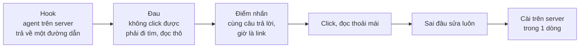

# A1. mdview hero demo: kịch bản và shot list

Ngày: 2026-10-26 (bản 2, viết lại theo pain anh xác nhận). Ý tưởng gốc: [A1 trong đợt 1](https://github.com/vantt/vlog/blob/main/docs/video-ideas/2026-10-de-xuat-video.md) (repo vlog, private).

## 1. Pain point (theo lời anh)

> Người làm việc trên **remote server**. Agent (Claude Code, Codex…) chạy trên server Linux, viết file `.md` ở đó, rồi chỉ trả về **đường dẫn tương đối, không click được**. Muốn đọc phải mở IDE remote, tìm file trong cây thư mục, rồi đọc markdown.
>
> mdview cho agent trả về **link http click được**. Click là đọc ngay, không cần thêm gì. Trang được trình bày để đọc dễ và thoải mái, và **sửa file được ngay trong trình duyệt**, không cần thêm công cụ.

Ba lợi ích theo thứ tự quan trọng:

1. **Một click từ câu trả lời của agent tới trang đọc.** Không IDE, không tìm file.
2. **Đọc thoải mái:** bảng, Mermaid, code có highlight, mục lục.
3. **Sửa tại chỗ:** nút Edit, sửa, Save.

Đã kiểm trên bản cài 0.8.8: có nút **Edit** (editor CodeMirror, có textarea dự phòng), thanh trạng thái "Unsaved changes", nút Save và Cancel. **[Quan sát]** Repo `~/projects/mdview` trên máy đang ở 0.5.2, cũ hơn bản cài. Quay video bằng bản mới nhất.

## 2. Brief

| Mục | Nội dung |
|---|---|
| Mục tiêu | Lấp chỗ `hero-demo` đang chừa trong README mdview. Là video đầu tiên được đăng. |
| Người xem | Dev chạy agent trên máy remote: server qua SSH, cloud dev box, VM, WSL. Họ quen cảnh agent in ra `docs/plans/x.md` rồi phải tự đi tìm. |
| Một ý duy nhất | **Agent viết xong, anh click là đọc được. Sai đâu sửa luôn.** |
| Thời lượng | 45 giây (bản đủ), 30 giây (bản cho README). |
| Định dạng | Bản gốc 16:9, 1920×1080, 30 fps. Từ đó xuất MP4/GIF cho README, 9:16 cho Shorts/X. |
| Âm thanh | Không voice. Chữ trên màn hình kể chuyện. Nhạc nhẹ, có thể tắt. |
| Ngôn ngữ | Tiếng Anh. Phụ đề Việt khi đăng lên kênh Việt. |
| Archetype | A1 rút gọn, chỉ quay màn hình. |

### Nguyên tắc

- **Phần nhìn phải đẹp, và duyệt trước khi dựng.** Rút kinh nghiệm từ phim skillstation: anh chưa ưng vì graphic, màu sắc và phong cách không đẹp. Chốt bảng màu, font, theme terminal và trình duyệt, kiểu chữ trên màn hình. Làm 3 style frame tĩnh (cảnh 1, 4, 7) để anh duyệt trước khi quay và dựng.
- **Màn hình thật.** Dev tin cái họ thấy chạy.
- **Một khoảnh khắc đắt giá:** cùng một câu trả lời của agent, trước là đường dẫn chết, sau là link sống. Click, trang hiện ra.
- **Cảnh "trước" là thao tác chung** (`cat` markdown thô, đi tìm file), không quay hay gọi tên sản phẩm của hãng khác.
- **Nói thật về bảo mật:** mdview bắt buộc đăng nhập bằng token (mặc định `demo`, phải đổi). Khi quay, đăng nhập trước để không lộ token, và đổi token khỏi giá trị mặc định.

## 3. Mạch kể



## 4. Shot list

Mốc thời gian là của bản 45 giây. Cột "Bản 30s" đánh dấu cảnh giữ lại cho README.

| # | Thời gian | Hình | Hành động | Chữ trên màn hình | Bản 30s |
|---|---|---|---|---|---|
| 1 | 0:00–0:05 | Terminal SSH, prompt `dev@build-01` cho thấy rõ là server. Claude Code đang chạy. | Agent kết thúc: *"Wrote the plan to `docs/plans/payment-retry.md`."* Con trỏ lướt qua đường dẫn. | **Your agent runs on a server.** rồi **Its docs stay there.** | có |
| 2 | 0:05–0:13 | Cùng terminal | Ctrl+click vào đường dẫn: không có gì xảy ra. Cắt nhanh (tua 3×): mở cửa sổ IDE remote đang kết nối, bấm qua cây thư mục `docs/` → `plans/`, mở file, thấy markdown thô (bảng lệch, khối ` ```mermaid ` dạng code). Đồng hồ nhỏ góc màn hình đếm giây. | **Not clickable.** rồi **Connect. Dig. Squint.** | có (rút còn 5s) |
| 3 | 0:13–0:18 | Terminal, cùng phiên, đã cài mdview | Cùng yêu cầu, agent trả lời *"Plan written. View it: `http://build-01:7700/s/…`"*. Link gạch chân. Click. | **Same agent. Now it hands you a link.** | có |
| 4 | 0:18–0:27 | Trình duyệt trên laptop | Trang hiện ra trong khoảng 1 giây: tiêu đề, bảng gọn, sơ đồ Mermaid đã render, code có highlight, mục lục bên phải. Cuộn chậm, zoom vào sơ đồ. | **One click. Easy to read.** | có (rút còn 6s) |
| 5 | 0:27–0:37 | Trình duyệt | Thấy một chỗ sai trong plan (ví dụ `max_retries: 10` thay vì `3`). Bấm **Edit**, sửa, **Save**. Trang render lại với số đúng. | **Spot a mistake? Fix it right here.** rồi **No IDE needed.** | có (rút còn 6s) |
| 6 | 0:37–0:40 | Trình duyệt | Click một link sang `../adr/0003-retry-policy.md`, mở được ngay. | **Every link works.** | không |
| 7 | 0:40–0:45 | Nền trơn, chữ lớn | Tên, câu định vị, lệnh cài | **mdview**<br/>Click your agent's docs. Read. Fix.<br/>`curl -fsSL …/install.sh \| sh`<br/>`mdview doctor --fix`<br/>Login token · LAN or SSH tunnel · github.com/vantt/mdview | có (rút còn 4s) |

Cảnh tùy chọn nếu còn chỗ:
- **Mobile:** mở cùng link trên điện thoại trong mạng LAN để đọc plan khi rời bàn. Chữ **Or on your phone.**
- **Live reload:** agent sửa file tiếp, trang tự cập nhật. Đây là điểm nhấn của bản trước, giờ chỉ là cảnh phụ.

### Vì sao cảnh 3 là điểm nhấn

Cảnh 1 và cảnh 3 dùng **cùng khung hình, cùng prompt, cùng câu trả lời**. Chỉ khác một chỗ: đường dẫn chết thành link sống. Người xem tự so sánh mà không cần chữ giải thích. Khi dựng, có thể làm cảnh 3 bằng cách chồng hình: dòng đường dẫn cũ biến thành link.

## 5. Quy tắc hình

- **Terminal:** theo bộ của skillstation (`settings.tape`): 1920×1080, cỡ chữ 26, theme Catppuccin Mocha, không nháy con trỏ. Prompt phải hiện tên máy server (`dev@build-01:~/acme-payments$`) để người xem hiểu đây là remote.
- **Trình duyệt:** 1920×1080, zoom trang 125%. Ẩn bookmark, extension, tab thừa. Thanh địa chỉ để thấy `build-01:7700`, để rõ là đọc từ server. Theme sáng cho bản README.
- **Chữ trên màn hình:** tối đa 7 từ một dòng, giữ ít nhất 1,5 giây, cố định ở dải dưới 1/5 khung hình.
- **Con trỏ chuột:** phóng to, có vệt click. Cú click ở cảnh 3 phải thật rõ.
- **Zoom vào hành động:** cảnh 3 (link), 4 (sơ đồ), 5 (dòng đang sửa) zoom 1,3–1,5 lần.
- **Bản 9:16:** cảnh 1–3 crop vào vùng câu trả lời của agent; cảnh 4–5 crop vào cột nội dung.
- **Không lộ thông tin thật:** tên máy, IP, user là giả. Không quay `~/.ssh`, token hay biến môi trường.

## 6. Dữ liệu và môi trường demo

**Server giả:** một VM hoặc container Linux, hostname `build-01`, user `dev`. Cài mdview, chạy `mdview doctor --fix`. Truy cập từ laptop qua SSH tunnel (`ssh -L 7700:localhost:7700`) hoặc LAN riêng. Nếu dùng tunnel thì link sẽ là `localhost:7700`, mất ý "đây là server". Nên dùng LAN riêng với hostname `build-01`.

**Project giả** `acme-payments/` trên server:

```
acme-payments/
└── docs/
    ├── plans/
    │   └── payment-retry.md      ← file chính: bảng, Mermaid sequence, code, link sang adr/, có lỗi max_retries: 10
    ├── adr/
    │   └── 0003-retry-policy.md  ← đích của link ở cảnh 6
    ├── api/
    │   └── payments.md
    └── runbooks/
        └── incident-response.md
```

Không cần 38 file như bản trước. Cảnh 2 chỉ cần cây thư mục đủ sâu để việc đi tìm trông mất công.

**Prompt cho agent ở cảnh 1 và 3:** *"Write an implementation plan for retrying failed payments to docs/plans/payment-retry.md."* Ở cảnh 3, agent đã có hướng dẫn mdview trong `CLAUDE.md` nên tự gọi `mdview_view_file` và trả về link.

## 7. Cách quay

| Cảnh | Công cụ | Ghi chú |
|---|---|---|
| 1, 3 | **Quay thật** bằng OBS: Claude Code chạy trên server | Không giả giao diện agent. Quay vài lần, giữ câu trả lời ngắn nhất. Hai lần chạy dùng cùng prompt. |
| 2 | OBS, sau đó tua 3× khi dựng | Cảnh duy nhất dàn dựng thao tác "đi tìm file". Làm như người dùng thật vẫn làm. |
| 4, 5, 6 | Playwright `recordVideo` (theo `skillstation/video/demos/web/record.mjs`) hoặc OBS | Playwright cho ra bản sạch và lặp lại được; bấm Edit, gõ, Save đều tự động hóa được. |
| 7 | DaVinci hoặc Remotion | Một khung tĩnh có chữ chạy vào. |

Ghép, chữ, zoom làm trong DaVinci Resolve. **Không viết pipeline tự động cho video này**.

### Xuất bản

| Bản | Thông số | Dùng ở |
|---|---|---|
| Gốc | 1920×1080, 30 fps, H.264 | YouTube, X |
| README | MP4 30s tải lên GitHub (README phát được video), hoặc GIF rộng 1280, 15 fps, dưới 10 MB | `docs/assets/hero-demo.*` trong mdview |
| Dọc | 1080×1920, phụ đề cháy vào hình | Shorts, TikTok |

## 8. Việc cần làm

1. ~~Chốt bộ nhìn và làm style frame.~~ Xong, xem [style-frames/](style-frames/README.md).
2. ~~Dựng server giả `build-01` và project `acme-payments/`.~~ Xong: `~/projects/mdview/video/hero-demo/` (`sandbox.sh`, daemon demo cổng 7710, link in `build-01`).
3. Kiểm trong terminal của anh: link `build-01` có click được không (cần `127.0.0.1 build-01` trong file hosts, cả phía Windows nếu trình duyệt chạy trên Windows).
4. ~~Quay cảnh 1–3.~~ Xong, tự động: `video/hero-demo/tapes/render.sh` quay cảnh 1+2 trong một take VHS, rồi cảnh 3. Cách quay tay cảnh 2 còn giữ làm dự phòng: [hướng dẫn](manual-scene-2.md).
5. ~~Quay cảnh 4–6.~~ Xong, cùng lệnh trên, chạy trên chính plan agent viết ở cảnh 3 để chỗ nối khớp.
6. ~~Dựng bản 45s và 30s.~~ Xong bằng Remotion (`video/hero-demo/edit/`): `out/hero-45s.mp4` (43s), `out/hero-30s.mp4` (32s). Còn: bản 9:16, và anh duyệt bản 30s.

## 9. Câu hỏi còn mở

- **README hiện tại** mở bằng "cross-folder links that never 404". Video giờ dẫn bằng pain remote. Có nên sửa luôn câu mở đầu README cho khớp không?
- Cảnh cuối có cần logo không? mdview chưa có logo.
- Ngoài README, video sẽ đăng ở đâu?
