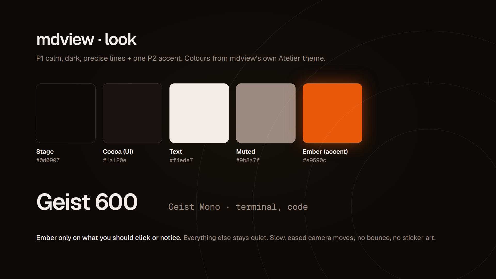
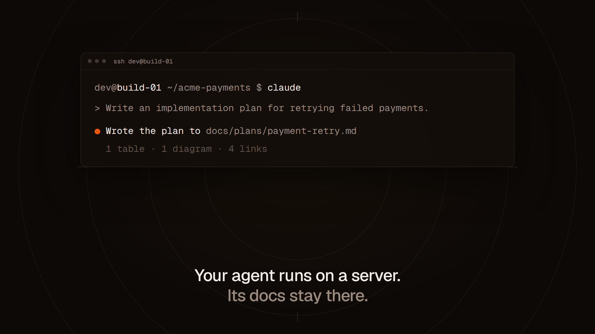
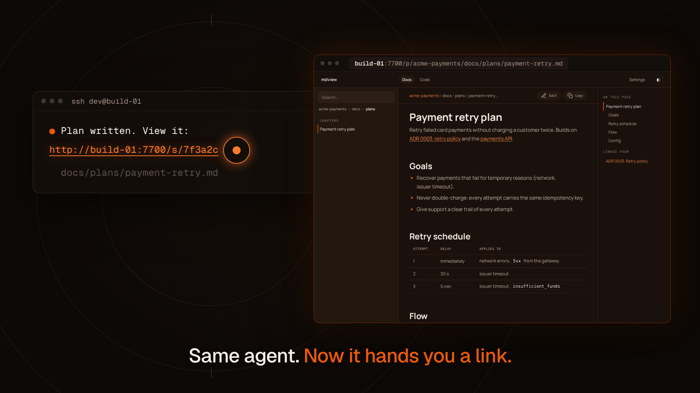
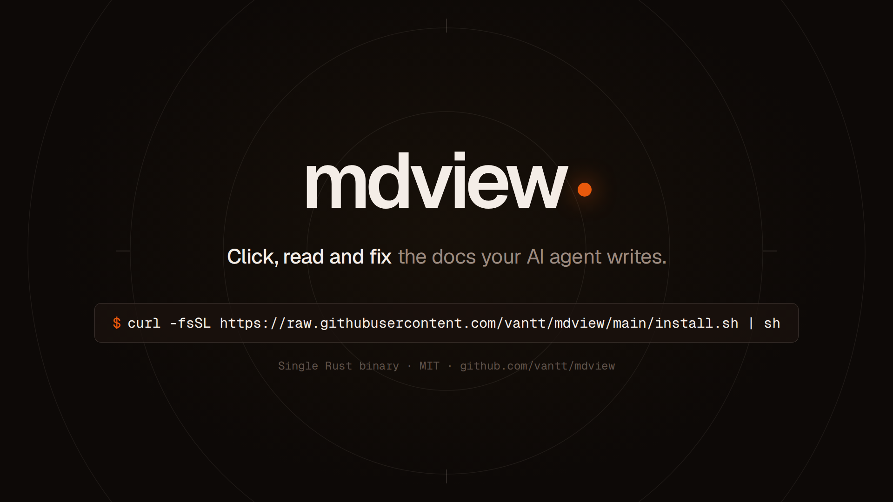

# Style frame: mdview

Ngày: 2026-10-26. Khung tĩnh duyệt phần nhìn **trước khi** quay và dựng. Phong cách chọn từ [mẫu phần nhìn](https://github.com/vantt/vlog/blob/main/docs/video-ideas/mau-phan-nhin.md) (repo vlog, private): P1 cộng màu nhấn kiểu P2.

## P1 + màu nhấn P2

Nền tối, nét mảnh, yên tĩnh. **Chỉ một màu nhấn: ember** (cam cháy), và chỉ dùng cho thứ người xem cần click hoặc để ý. Màu lấy từ chính design system Atelier của mdview, nên khung quay màn hình và phần đồ họa ăn khớp nhau.

| Khung | Cảnh trong [kịch bản A1](../script.md) |
|---|---|
|  | Bảng màu, font, quy tắc |
|  | Cảnh 1: agent trên server trả về đường dẫn chết |
|  | Cảnh 3: điểm nhấn. Cùng agent, giờ là link; click ra trang |
|  | Cảnh 7: tên, câu định vị, lệnh cài |

- Font: **Geist** 600 cho chữ, **Geist Mono** cho terminal.
- Trang mdview trong khung 3 là **ảnh chụp giao diện thật** (bản 0.8.8, theme tối), mở file plan giả `payment-retry.md`.
- Chuyển động dự kiến: camera lướt chậm, có easing, không nảy, không sticker.

## Lưu ý

- Terminal trong khung hình là **dựng bằng HTML để thể hiện phần nhìn**. Khi làm video thật, cảnh agent vẫn quay agent chạy thật, rồi áp theme và màu này.
- Tên repo, tên máy, phiên bản skill trong khung là giả.


## Làm lại

`frames.html`: mỗi `<section class="frame">` là một khung 1920×1080.

```bash
node render.mjs frames.html .
```

Chụp lại giao diện mdview thật (cần daemon mdview đang chạy; tự đăng nhập bằng `MDVIEW_TOKEN`, mặc định `demo`):

```bash
VW=1180 VH=860 node shoot-ui.mjs http://127.0.0.1:7700/p/acme-payments/docs/plans/payment-retry.md ui-reading.png
```

Playwright lấy từ `~/projects/skillstation/web/node_modules`.

## Góp ý

| Vòng | Ngày | Khung | Góp ý | Xử lý |
|---|---|---|---|---|
| 1 | 2026-10-26 | mdview cảnh 3 | Nội dung dính sát mép sidebar, thiếu lề trái (lỗi mdview ở màn hình hẹp) | Sửa CSS mdview (commit `5f2c3a2`), chụp lại. Anh duyệt. |
